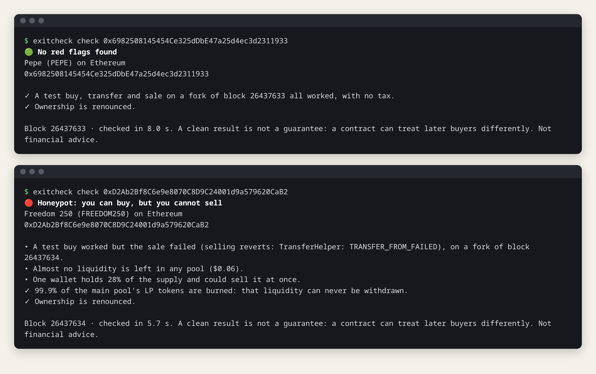

# exitcheck

[](https://github.com/amirradjou/exitcheck/actions/workflows/ci.yml)
[](LICENSE)

Paste a token address and exitcheck tells you whether the token is built to take your money. It reads the contract, buys and
sells a little of the token on a private copy of the chain, and gives a verdict with the reasons. Ethereum and Base.
(Formerly `rugcheck`.)



Real output of `exitcheck check`, run on 2026-11-17 against free public RPCs. FREEDOM250 is one of the labelled test tokens:
ownership renounced and liquidity burned, so it looks clean on paper, but the test sale fails.

## Run it

You need [Go 1.26](https://go.dev/dl/) and, for the simulation, [Foundry](https://getfoundry.sh)'s `anvil`. No keys: it runs
on free public RPCs.

```sh
git clone https://github.com/amirradjou/exitcheck && cd exitcheck
make build
./bin/exitcheck check 0x6982508145454Ce325dDbE47a25d4ec3d2311933               # PEPE on Ethereum
./bin/exitcheck check 0xD2Ab2Bf8C6e9e8070C8D9C24001d9a579620CaB2               # FREEDOM250, a honeypot
./bin/exitcheck check -chain base 0x532f27101965dd16442E59d40670FaF5eBB142E4  # BRETT on Base
```

The Telegram bot, the live watch (`docker compose up`), the dataset and the model are in [docs/GUIDE.md](docs/GUIDE.md).

## How it works

1. **Contract facts.** Owner, holders, pools and whether their liquidity can be withdrawn. Privileged functions are found in
   the bytecode, and who can use them is tested by simulating the calls.
2. **Buy, transfer, sell** on an Anvil fork of the latest block, from a fresh wallet. This catches honeypots and taxes.
3. **Verdict.** Fixed rules give one of four levels (no red flags, caution, high risk, scam) and list the reasons. A
   language model never decides it. A check that did not finish is never read as a pass.
4. **Explanation**, optional. A language model explains the verdict in plain words. Any sentence that does not cite a check
   or a source line is dropped.
5. **Live watch.** New pools on Uniswap v2/v3 and Aerodrome go through Kafka to analyzer workers, and dangerous launches are
   posted to a Telegram channel.

## Results

Full tables and how each was measured: [docs/RESULTS.md](docs/RESULTS.md).

| Part | Measured |
|---|---|
| Contract facts | 20 of 20 tokens in the hand-labelled test set right (10 scams, 10 legitimate) |
| Simulation | 6 of 6 honeypots in the test set flagged, 0 of 10 legitimate tokens flagged |
| Bot | median answer 9.1 s, 0.5 ms from the cache, on the same test set |
| Live watch, one day (2026-10-30) | 264 launches checked, median 8.9 s from first liquidity to verdict, 0 duplicates. It missed 36 of Ethereum's 91 launches; that is fixed, but no full day has been measured since |
| Classifier | evaluated on a time split; not yet better than the rules across splits, so it is not in the verdict |
| Explanations | 58 of 58 sentences cite a check or a source line, read by hand |

On that measured day, 177 Uniswap v2 launches were flagged because the deployer still held the pool's liquidity tokens.
When the pools were read again right after the day, 168 had been emptied. For the 167 that traded first, the alert came a
median 13.1 minutes before the liquidity was pulled.

## Limits

- Not hosted. The [Telegram bot and alerts channel](https://t.me/rugcheckApp) only answer while I run the stack.
- A clean result is not a guarantee: a contract can treat later buyers differently. Uniswap v4 pools are not checked yet.
- Not financial advice. It never trades: simulations run on a local fork. Think a verdict is wrong? Open an issue.

## More

- [docs/GUIDE.md](docs/GUIDE.md): every command, the settings, and how each check works
- [docs/RESULTS.md](docs/RESULTS.md): each milestone's measurements and what they showed
- [docs/m5-review.md](docs/m5-review.md): every explanation from the review set

Go, Foundry/Anvil, Kafka, Postgres, Redis; Python with XGBoost and MLflow to train the model. MIT licence.
